# CityWheels help desk

Answer one customer question for a made-up bike rental shop. Refund amounts come from code. The model is not allowed to invent the figure.

```sh
git clone https://github.com/adagora/help-desk-agent.git
cd help-desk-agent
python3 -m citywheels --provider fake "I want to cancel booking CW-1002. How much will I get back?"
```

That prints:

```text
If you cancel booking CW-1002 now, you get 340 EUR back. That is 40 EUR of the rental price plus the 300 EUR deposit. The booking fee is not refunded. Refunded to the same card within 5 working days.
```

Python 3.11 or newer. `citywheels` and `casework` use the standard library only. There is no installer and no package on pip. The separate `orchestration` package needs `temporalio`. See `docs/cancellation-refund.md`.

`SOLUTION.md` is the longer write-up of the same tree.

## TL;DR

A help-desk reply that quotes a refund has to use the shop's clock, the booking status, and the stored price. A model that does that arithmetic in its head will drift.

This program loads the policy files and `data/bookings.json`, calls tools, and prints one answer. `calculate_refund` computes the euros. The shop clock is fixed, so the same question returns the same quote.

| What you can do | How |
| --- | --- |
| Cancel quote with no API key | `--provider fake` |
| Same loop on a hosted model | `--provider openai` or `--provider gemini` |
| One JSON object for another program | `--json` |
| See commands without calling a model | no arguments, or `capabilities` |
| Check the refund bands in code | `python3 verify/check_desk.py` |
| Check the same rules in TLA+ | TLC on `verify/Desk.tla` and `verify/AgentLoop.tla` |

## Quick example

Run these from the clone.

```sh
python3 -m citywheels
python3 -m citywheels --provider fake "What time do you open on Saturday?"
python3 -m citywheels --provider fake "How much is an e-bike for a whole day?"
python3 -m citywheels --provider fake "Can my 14-year-old rent an e-bike?"
python3 -m citywheels --provider fake "I want to cancel booking CW-1002. How much will I get back?"
python3 -m citywheels --provider fake "I want to cancel booking CW-9999. How much will I get back?"
python3 -m citywheels --provider fake "What is the capital of Australia?"
python3 -m citywheels --provider fake --json "I want to cancel booking CW-1002. How much will I get back?"
python3 -m citywheels capabilities
python3 -m unittest discover -s tests
python3 eval/run_eval.py
```

CW-9999 was never booked, so the answer sends the customer to the staff. The Australia question does the same. Neither invents a fact from outside the shop files.

The committed fake-model eval is 23 of 23. See `eval/results.md`. The fake model is a script, so read the live results next to it. See `eval/results-live-openai.md` and `eval/results-live-gemini.md`.

## Design

The refund function owns the money. `refund_for_booking` reads `rental_price_eur` on the booking. It does not look the price up again, and it does not ask the model to add. Exactly 48 hours before the start is a full rental refund. Exactly 24 hours is half. Under 24 hours the rental refund is zero. The deposit comes back only when the booking is still `confirmed`. The 2 EUR booking fee stays out of `refund_eur`.

One loop serves every provider. `FakeModel`, `OpenAIModel`, and `GeminiModel` all return text or tool calls. `run_agent` in `citywheels/agent.py` is the only place that runs tools.

The clock does not move. Bookings sit in June 2026. The desk treats the current time as 2026-06-10 09:00, Europe/Warsaw, UTC+02:00. Tests can pass another `now` into `run_agent`. The CLI does not.

The last round offers no tools. The program allows 6 rounds. If the model asks for tools on the last round, those calls are not run, and the customer gets the staff message. A tool that raises becomes an error result the model can read on the next round.

An unknown booking, a question the policies do not cover, and an empty model reply all use the same staff message, with `help@citywheels.example` and `+48 000 000 000`.

## How this compares

|  | This program | Reading the policy files | A framework agent |
| --- | --- | --- | --- |
| Offline answer | `fake`, no key, no network | You write the reply | Usually needs a hosted model |
| Refund figure | `refunds.py` | You calculate it | Whatever the model writes, unless you add a tool |
| OpenAI and Gemini | Same loop, direct HTTP | No | Yes, behind the framework |
| Records the cancellation | No | No | Only if you build that call |
| Setup | Clone the repo | Open `data/` | Install the framework and a key |

Use this when you want the quote to be the same on every run, and when you want to see the tool round in one file.

`citywheels` prints a quote. It leaves the booking file unchanged, and it never charges a card.

## Cancellation workflow

`orchestration/` is a second program in this repository. It runs one cancellation and refund on Temporal, against a fake booking store and a fake ledger on disk. `casework/` holds its checks on the standard library. The amount comes from `refund_for_booking`, the same function the quote uses. The model only asks for a cancellation through `request_cancellation`, which changes nothing.

```sh
python3 -m venv .venv
.venv/bin/pip install -r orchestration/requirements.txt
.venv/bin/python -m orchestration demo
```

Use Python 3.13 for that package. `python3 -m unittest discover -s tests` stays the standard-library suite and does not import `temporalio`. Run notes are in `docs/cancellation-refund.md`, and the design and its known gaps are in `docs/architecture.md`.

## Installation

### Clone

```sh
git clone https://github.com/adagora/help-desk-agent.git
cd help-desk-agent
python3 -m citywheels --version
```

`--version` prints `1`. That is the output contract, not a packaging version. `citywheels.__version__` is `1.0.0`. Tag `v1.0.0` is the release before this README. `main` is the commit you are reading.

```sh
git clone --branch v1.0.0 https://github.com/adagora/help-desk-agent.git
```

### Interpreter you already have

Any Python 3.11 or newer on `PATH` is enough. I ran the 74 unit tests on 3.12, 3.13, and 3.14. CI also runs 3.11.

```sh
python3.12 -m unittest discover -s tests
python3.13 -m unittest discover -s tests
python3.14 -m unittest discover -s tests
```

### Another data directory

The policies and bookings ship in `data/`. To point the command at a copy:

```sh
python3 -m citywheels --data-dir /path/to/data --provider fake "What time do you open on Saturday?"
```

That directory needs `policies/` and `bookings.json`.

No curl installer, Homebrew formula, or pip package is published.

## Quick start

1. Clone the repo and enter it.
2. Ask one question with `--provider fake`.
3. Read the answer on stdout. A correction or an error goes to stderr.
4. For a hosted model, copy `.env.example` to `.env` and set one key. Then drop `--provider`, or set it to `openai` or `gemini`.

## Commands

Global flags:

```text
--json           One JSON object on stdout
--provider       fake, openai, or gemini
--data-dir       Directory with policies/ and bookings.json
--robot-triage   Health and commands as JSON, no model call
--robot-help     Agent handbook
--no-color       Accepted. The command already prints plain text
--version        Print 1 and exit
-h, --help       Human help
```

`NO_COLOR` is accepted too. The command never prints color codes.

### Ask

```sh
python3 -m citywheels --provider fake "How much is an e-bike for a whole day?"
python3 -m citywheels --provider fake --json "How much is an e-bike for a whole day?"
```

`--json` keys are `ok`, `contract_version`, `answer`, `provider`, and `tool_trace`. Keys are sorted. The document is UTF-8 and ends with one newline.

A question that is itself a verb needs `--` in front of it:

```sh
python3 -m citywheels --provider fake -- capabilities
```

### No arguments

```sh
python3 -m citywheels
```

Prints a short triage and exits 0. Flags with no question exit 1 and name the ask command.

### `capabilities`

```sh
python3 -m citywheels capabilities
python3 -m citywheels capabilities --json
```

Both print the same JSON document: commands, exit codes, flags, providers.

### `robot-docs guide`

```sh
python3 -m citywheels robot-docs guide
python3 -m citywheels robot-docs guide --json
python3 -m citywheels --robot-help
```

The handbook. `--json` wraps it as `ok`, `contract_version`, and `guide`.

### `robot-triage`

```sh
python3 -m citywheels --robot-triage
python3 -m citywheels robot-triage
```

Health, commands, and recommendations. It does not call a model. An extra question on this command is an error. Health keys include `data_dir`, `policies`, `booking_count`, and `bookings_readable`.

### `help`

```sh
python3 -m citywheels help
python3 -m citywheels --help
```

### Exit codes

| Code | Name | When |
| --- | --- | --- |
| 0 | success | The command finished |
| 1 | user-input-error | Bad arguments, unknown `--provider` spelling, or a missing data directory |
| 2 | safety-block | Reserved. Nothing returns it today |
| 3 | tool-environment-error | Missing API key, or `CITYWHEELS_PROVIDER` is not a known name |
| 4 | transient-failure | The model host could not be reached |

A flag or provider value one edit from a single known spelling is corrected on stderr, and the command continues. `--jsno` becomes `--json`. Two candidates at the same distance are not guessed.

Verbs are recognized only as the first argument: `capabilities`, `robot-docs`, `robot-triage`, `help`.

## Configuration

Copy `.env.example` to `.env`. Lines are `KEY=value`. The CLI reads `.env` from the current directory and from parent directories.

```sh
# fake, openai, or gemini.
# If this line is omitted, openai is used when OPENAI_API_KEY is set,
# otherwise gemini when GEMINI_API_KEY is set, otherwise fake.
CITYWHEELS_PROVIDER=openai

OPENAI_API_KEY=
OPENAI_MODEL=gpt-4o-mini
OPENAI_BASE_URL=https://api.openai.com/v1

GEMINI_API_KEY=
GEMINI_MODEL=gemini-3.8-flash
```

`--provider` on the command wins over `CITYWHEELS_PROVIDER`. `fake` ignores any key.

## Shop data

| File | What it holds |
| --- | --- |
| `data/policies/prices.md` | Bike types, rental prices, add-ons, deposits, late return fees |
| `data/policies/cancellations.md` | Cancel, change, and refund rules |
| `data/policies/faq.md` | Hours, age limits, payment, and what to do when something goes wrong |
| `data/bookings.json` | Example bookings |

| Field | Meaning |
| --- | --- |
| `id` | Booking number, such as `CW-1001` |
| `status` | `confirmed`, `in_progress`, `completed`, or `cancelled` |
| `bike_type` | `city`, `e-bike`, or `kids` |
| `bikes` | How many bikes are booked |
| `start`, `end` | Rental window, with the time zone |
| `add_ons` | Extras, such as `child_seat` |
| `rental_price_eur` | Rental price, including add-ons |
| `booking_fee_eur` | Online booking fee |
| `deposit_eur` | Deposit paid with the booking |
| `paid_with` | `card` or `voucher` |

## Example questions

- What time do you open on Saturday?
- How much is an e-bike for a whole day?
- I want to cancel booking CW-1002. How much will I get back?
- Can my 14-year-old rent an e-bike?
- What is the capital of Australia?

The last one is in the set on purpose. The policies do not contain it.

## Architecture

```text
python3 -m citywheels
        |
        v
citywheels/cli.py          argv, .env, exit code
        |
        v
citywheels/agent.py        up to 6 rounds, no tools on the last round
        |
        +-- FakeModel | OpenAIModel | GeminiModel
        |
        v
citywheels/tools.py
        |-- search_policies      data/policies/*.md
        |-- get_booking          data/bookings.json
        |-- calculate_refund     citywheels/refunds.py
        |                        citywheels/schedule.py for a change
        +-- request_cancellation names a write intent, changes nothing
```

`search_policies` returns verbatim passages by keyword overlap. There are no embeddings. `get_booking` returns the stored fields or a not-found result. `calculate_refund` calls `refund_for_booking` at the fixed clock.

A change is allowed only while the booking is `confirmed` and at least 24 hours remain. `python3 verify/check_desk.py` walks every status and every band, `far` at 48 hours, `mid` at 24 hours, and `near` at one second under 24 hours. The unit tests call that script too.

## Models

Two TLA+ models in `verify` cover the parts that have state. Run TLC on both with tla2tools 1.8.0, and run `python3 verify/check_desk.py`. The `verify` job in `.github/workflows/ci.yml` does that. The jar is pinned by its sha256. The release sha1 is `551796d155f630b9c36631f3c94afe8f410e0f92`.

The model bound is smaller than the program. `verify/AgentLoop.cfg` sets `MaxRounds = 3` and `MaxCalls = 2`. The program's `MAX_ROUNDS` is 6.

### One booking at the desk

`verify/Desk.tla` is one booking. TLC tries every order of the clock, the rental, a cancel question, and a change question.

Two rules hold in all 320 states TLC reached. A full quote appears only for a confirmed booking 48 hours or more before the start. A half quote appears only from 24 hours up to 48. A deposit-only quote appears only under 24 hours. A quote of nothing appears only when the booking is not confirmed. A change is allowed while the booking is confirmed and at least 24 hours remain, and refused otherwise.

The chart draws 15 states and 18 arrows. It leaves out the clock moving, the rental starting, the rental ending, and the booking being marked cancelled. Those steps do not change the words on the state by themselves. The Mermaid source is `verify/chart.mmd`. The run notes are `verify/report.md`.



### One question through the agent loop

`verify/AgentLoop.tla` is `run_agent` and `run_tool`. With 3 rounds and up to 2 tool calls in a turn, TLC reached 34 states at depth 10. The model reads every tool result before its next call. The loop stays inside the limit. Every finished run has an answer. No run stops with an exception. No tool result is thrown away. Every run ends.

The chart draws 7 states and 11 arrows. It hides the step where one tool returns or fails. The Mermaid source is `verify/agentloop.chart.mmd`. The run notes are `verify/agentloop.report.md`.


The models leave out prices, vouchers, storm wording, policy text, and the words the model writes. The agent model counts tool results and does not model provider errors from `openai_model.py` or `gemini_model.py`.

## Tests and CI

```sh
python3 -m unittest discover -s tests
python3 eval/run_eval.py
python3 verify/check_desk.py
.venv/bin/python -m unittest orchestration.tests.test_workflow
.venv/bin/python -m unittest orchestration.tests.test_audit_link
```

`test_workflow` needs `temporalio` and starts a local Temporal server. `test_audit_link` also needs a built ai-audit checkout and skips without it.

File checks and the unit tests also run through [prek](https://github.com/j178/prek) 0.5.9, locally and in CI:

```sh
prek run --all-files
```

`.github/workflows/ci.yml` runs that gate on Python 3.11, 3.12, 3.13, and 3.14. A second job runs the two TLC models and `verify/check_desk.py` on Java 21 with tla2tools 1.8.0. A third job runs the workflow tests on Python 3.13.

To run TLC yourself, from `verify/`:

```sh
java -XX:+UseParallelGC -jar /path/to/tla2tools.jar -workers 1 -config Desk.cfg Desk.tla
java -XX:+UseParallelGC -jar /path/to/tla2tools.jar -workers 1 -config AgentLoop.cfg AgentLoop.tla
```

## Troubleshooting

### Exit 3, missing key

`CITYWHEELS_PROVIDER=openai` with an empty `OPENAI_API_KEY` exits 3. Fill the key, or run the fake provider:

```sh
python3 -m citywheels --provider fake "What time do you open on Saturday?"
```

An unknown `CITYWHEELS_PROVIDER` value is the same exit code. `--provider` with a value that is not a known spelling, and is not one edit from one spelling, exits 1.

### Exit 4, host unreachable

The provider host did not answer. Retry, or use `--provider fake`. Exit 4 is the transient failure.

### Exit 1, flags and no question

```sh
python3 -m citywheels --provider fake
```

That is not a question. The error names the ask command. Run `python3 -m citywheels` with no flags for the triage.

### Stderr says a flag was corrected

`--jsno` is one edit from `--json` and from nothing else, so the command continues and says so on stderr. If you meant a different flag, pass the full name.

### The answer tells the customer to contact the staff

That is the result for an unknown booking, an off-topic question, an empty model reply, or a model that still wants tools on the last round. CW-9999 and the Australia question are the examples.

### `python3` is older than 3.11

The package uses syntax from 3.11. Use `python3.12` or newer if `python3 --version` is older.

## Limitations

The fake model is a script. It covers the eval questions and the same shapes, such as "cancel booking CW-..." and "what time do you open". Keyword overlap is the whole policy search. A hours question with none of those words can miss the summer line.

`eval/results.md` is the fake-model score, 23 of 23. `eval/results-live-openai.md` and `eval/results-live-gemini.md` are the same questions on hosted models. `eval/holdout-live.md` is an older, short run.

`citywheels` does not store a cancellation, charge a card, or fetch a weather report. A storm warning is a staff decision. `orchestration` changes only its own fake backend. `docs/architecture.md` lists its known gaps.

Opening hours in the fake model use June 2026 even when a test passes another `now` into `run_agent`. Refund math uses that argument.

The customer cannot ask "what if I cancel tomorrow". `calculate_refund` has no time argument. Only the caller of `run_agent` can pass `now`.

TLC checked 3 rounds and 2 calls, not the program's 6 rounds. It does not check provider HTTP errors.

Exit code 2 is reserved and unused.

## FAQ

### Why is the clock stuck in June 2026?

So a cancel quote does not change because you ran the command on a different day. The bookings were written against that morning.

### Why is the booking fee missing from the refund?

The cancellation rule leaves it out. CW-1002 is 40 EUR of the rental plus the 300 EUR deposit, 340 EUR. The 2 EUR fee is not in that sum.

### Does a cancel answer cancel the booking?

No. `citywheels` quotes the refund and, on a clear request, returns a write intent. `data/bookings.json` stays as it was. Only `orchestration` changes a booking, in its own fake backend, after the customer confirms the exact quote.

### Which file should I read first?

`citywheels/agent.py` for the loop, `citywheels/refunds.py` for the money, `citywheels/cli.py` for the command. `SOLUTION.md` walks the same choices in prose.

### Do I need an API key to review this?

No. `--provider fake` is the default when no key is set. The unit tests and `eval/run_eval.py` need no network.

### What does a tool error look like?

`run_tool` turns a bad argument, an unknown tool, and an exception inside a tool into an error result. The model reads that result. The process does not stop on the exception.

## Contributions

This is a take-home sample. I am not accepting pull requests on it.

Bug notes are still useful if you are reviewing the tree. The checks to re-run are `python3 -m unittest discover -s tests`, `python3 eval/run_eval.py`, and `python3 verify/check_desk.py`.
