# CityWheels help desk — base data

CityWheels is a made-up bike rental shop. These files hold the data for its help desk agent. There is no code here: you write it.

## Files

| File | What it holds |
| --- | --- |
| `data/policies/prices.md` | Bike types, rental prices, add-ons, deposits and late return fees. |
| `data/policies/cancellations.md` | Rules for cancelling or changing a booking, and for refunds. |
| `data/policies/faq.md` | Answers to common questions: opening hours, age limits, payment, what to do when something goes wrong. |
| `data/bookings.json` | Example bookings. |

## Bookings

Each booking in `data/bookings.json` has these fields:

| Field | Meaning |
| --- | --- |
| `id` | Booking number, for example `CW-1001`. |
| `status` | `confirmed`, `in_progress`, `completed` or `cancelled`. |
| `bike_type` | `city`, `e-bike` or `kids`. |
| `bikes` | How many bikes are booked. |
| `start`, `end` | When the rental starts and ends, with the time zone. |
| `add_ons` | Extras, such as `child_seat`. |
| `rental_price_eur` | Price of the rental itself, with add-ons. |
| `booking_fee_eur` | Fee for booking online. |
| `deposit_eur` | Deposit paid with the booking. |
| `paid_with` | `card` or `voucher`. |

## The current date

The bookings are set in June 2026. So that answers are the same every time, treat the current date and time as:

**2026-06-10 09:00, Europe/Warsaw time (UTC+02:00).**

## Example questions

- What time do you open on Saturday?
- How much is an e-bike for a whole day?
- I want to cancel booking CW-1002. How much will I get back?
- Can my 14-year-old rent an e-bike?
- What is the capital of Australia?

## Command

From this directory, one customer question is:

```sh
python3 -m citywheels --provider fake "I want to cancel booking CW-1002. How much will I get back?"
```

With no arguments, the command prints a short agent triage and exits 0. `capabilities` prints the machine-readable contract. `robot-docs guide` prints the agent handbook. `--robot-triage` prints data-pack health and those commands as JSON, and it does not call a model. `--json` wraps an answer. `--help` lists the flags.

## Statechart

`verify/Desk.tla` is one booking at the desk. TLC checks every order of the clock, the rental, a cancel question, and a change question. The pstack 0.15.36 `/statechart` skill drew the chart from that model. Pele rendered `verify/chart.svg`. The Mermaid source is `verify/chart.mmd`, and the run notes are `verify/report.md`.

Two rules hold in all 320 states TLC reached. A full quote was given only for a confirmed booking 48 hours or more before the start. A half quote was given only from 24 hours up to 48. A deposit-only quote was given only under 24 hours. A quote of nothing was given only when the booking was not confirmed. A change was allowed while the booking was confirmed and at least 24 hours remained, and it was refused otherwise.

The chart draws 15 states and 18 arrows. It leaves out the clock moving, the rental starting, the rental ending, and the booking being marked cancelled. Those steps do not change the words on the state by themselves. Marking a booking cancelled after both answers are already in stays on the same label, so that arrow is not drawn either.

`python3 verify/check_desk.py` checks the euro amounts for every status and every band, including that the 2 EUR booking fee stays out of the refund. The model leaves out prices, vouchers, the agent loop, and storm wording. No rule breaks, so the chart has no red state.

```mermaid
stateDiagram-v2
  state "Legend" as legend {
    lg0: waiting
    lg1: quoted
    lg2: blocked
  }
  class lg0 blue
  class lg1 teal
  class lg2 orange
  s0: No quote yet
  s1: Full refund quoted
  s2: No quote yet, and a change was allowed
  s3: Nothing refunded
  s4: Full refund quoted, and a change was allowed
  s5: Half refund quoted
  s6: No quote yet, and a change was refused
  s7: Nothing refunded, and a change was refused
  s8: Nothing refunded, and a change was allowed
  s9: Deposit only quoted
  s10: Full refund quoted, and a change was refused
  s11: Half refund quoted, and a change was allowed
  s12: Deposit only quoted, and a change was refused
  s13: Deposit only quoted, and a change was allowed
  s14: Half refund quoted, and a change was refused
  [*] --> s0
  s0 --> s1: you ask to cancel, and the quote is the full rental plus the deposit
  s0 --> s2: you ask to change the booking
  s1 --> s4: you ask to change the booking
  s2 --> s4: you ask to cancel, and the quote is the full rental plus the deposit
  s0 --> s3: you ask to cancel, and nothing is refunded
  s0 --> s6: you ask to change the booking
  s0 --> s5: you ask to cancel, and the quote is half the rental plus the deposit
  s3 --> s7: you ask to change the booking
  s1 --> s10: you ask to change the booking
  s5 --> s11: you ask to change the booking
  s6 --> s7: you ask to cancel, and nothing is refunded
  s2 --> s8: you ask to cancel, and nothing is refunded
  s2 --> s11: you ask to cancel, and the quote is half the rental plus the deposit
  s0 --> s9: you ask to cancel, and the quote is the deposit only
  s9 --> s12: you ask to change the booking
  s5 --> s14: you ask to change the booking
  s6 --> s12: you ask to cancel, and the quote is the deposit only
  s2 --> s13: you ask to cancel, and the quote is the deposit only
  class s0 blue
  class s1 teal
  class s2 blue
  class s3 orange
  class s4 teal
  class s5 teal
  class s6 blue
  class s7 orange
  class s8 orange
  class s9 teal
  class s10 teal
  class s11 teal
  class s12 teal
  class s13 teal
  class s14 teal
```



