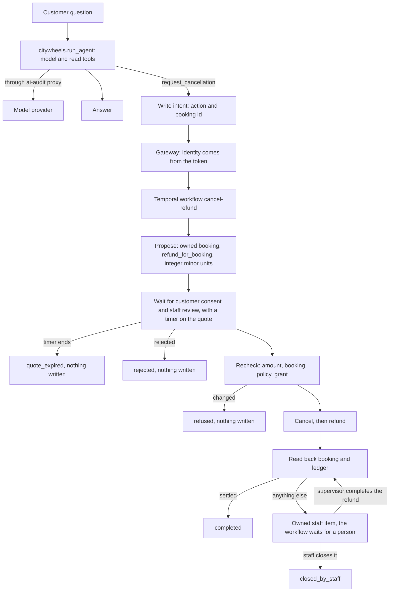

# Architecture

This repository holds the help-desk application. It has three layers. Dependencies point one way: `orchestration/` imports `casework/`, and `casework/` imports `citywheels/`. `tests/test_architecture.py` enforces it.

| Package | Job | Needs |
|---|---|---|
| `citywheels/` | One customer question: model, read tools, the refund rule | Standard library |
| `casework/` | The checks around one cancellation: proposal, consent, review, grant, recheck, read-back | Standard library |
| `orchestration/` | Waits and orders the steps on Temporal. With `cockpit/`, it is the only package that imports `temporalio` | `temporalio` |
| `cockpit/` | The operator page. Reads Temporal, the stores, the ai-audit log and IntentGauge reports, and acts only through the gateway. Nothing imports it | `temporalio` |

The operator page is described in [cockpit.md](cockpit.md). The gateway, Auditline (repository `ai-audit`), is a separate product. [ai-audit ADR 0066](https://github.com/adagora/ai-audit/blob/main/docs/adr/0066-help-desk-repository-and-temporal-write-intents.md) records this split.

## The flow

The model issues a write intent and never writes. `request_cancellation` returns the intent and changes nothing. The amount comes from `refund_for_booking`, never from the model or the request.

Question answering does not run on Temporal. A question has no durable state and no write. One workflow runs per write-intent type, and today that is `cancel-refund`.

## Why Temporal, and how much

[The Counting House](https://yegge.ai/essays/the-counting-house/) calls for "one saga definition per write-intent type" and says "essentially every CH is going to need something like Temporal". It also targets "tens of thousands of contacts or cases per day" and calls a hosted engine "a perfectly good engine for your first handful of intents". CityWheels does not have that volume.

Temporal earns its place here for three things: a wait that outlives a process, retries with long backoff, and a case that stays open until a person closes it. It adds a server to run and workflow versioning to respect. If a deployment has one or two intents and a hosted engine inside its compliance perimeter, that engine is a reasonable substitute. `casework/` has no Temporal import, so the rules move with it.

Temporal does not make a refund exactly once. An activity can run twice, so the backend deduplicates by operation id, and the workflow reads back before it reports anything. Temporal history is not a compliance archive, which is why evidence goes to the ai-audit log.

## What each failure does

| Failure | Result |
|---|---|
| No consent before the quote expires | `quote_expired`. Nothing written. A new request gets a new quote and needs new consent |
| A consent or review that does not match the digest of the quote | Ignored. The case keeps waiting |
| A review from the customer | Ignored |
| Grant revoked, booking changed, policy changed or refund band changed during the wait | `refused`. Nothing written |
| Worker process killed during the wait | The case keeps waiting. Signals are accepted while no worker runs. A new worker continues it |
| Worker dies after the cancel write | A new worker retries. The backend keeps one cancellation and one refund |
| Every refund acknowledgement lost | The workflow reads back, finds the refund and reports `completed` |
| A read-back fails once | Retried |
| A read-back never answers | Owned staff item `backend_evidence_unavailable`. No success is claimed |
| Refund fails after the cancel | Owned staff item `cancelled_refund_unsettled`. A supervisor can complete the refund after a recheck. There is no rollback |
| Ledger differs from the proposal | Owned staff item `readback_mismatch`. It cannot be completed, only closed by staff |
| A storm claim | Owned staff item `staff_required_for_claim`. Nothing written |
| Duplicate request while a case is open | Attaches to that case |
| Request after a settled refund | `already_settled`, from read-back. Nothing written |
| Evidence is configured and cannot be kept | Owned staff item `evidence_unavailable`, before any write |

## Identity and trust

`orchestration/gateway.py` takes the tenant, the customer and the roles from the token. A request cannot name them. The fake `Directory` stands in for real authentication.

A signal carries an actor name, and the workflow trusts its sender. Anyone with access to the Temporal namespace can send a signal, so that access is the trust boundary. A real deployment needs the gateway behind real authentication, and signed approvals if the namespace is shared.

`recheck` and `recheck_resolution` run in activities, because they read current facts. The workflow only checks that an approval binds to the digest of the exact proposal.

## Evidence

The application reaches ai-audit in two optional ways. Neither is on the money path.

- **Model traffic.** Set `OPENAI_BASE_URL` to the proxy and `OPENAI_API_KEY` to an `aia-` client key. Keep the provider key in the proxy. The `--provider gemini` path does not go through the proxy, because the proxy speaks the OpenAI and Anthropic APIs.
- **Decisions.** Set `AI_AUDIT_CLI` to `dist/src/cli.js` of an ai-audit build, and `AI_AUDIT_LOG` to a log path. Each case then records `decide` with `policies/refund.json`, `approve` for the review, and `effect` for the outcome. `ai-audit replay` and `ai-audit console` read them. A QDL total that differs from `refund_for_booking` stops the case as `rule_disagreement`, before any write.

Without those variables, a result says `"evidence": "not-recorded"`. In redact mode the proxy masks email addresses and phone numbers, including the shop's own contacts in the system prompt. Start it with `--allow-hashes policies/proxy-allow.json` to let those two public values through.

Keep customer content out of workflow arguments. Temporal persists them, so `CaseRequest` and `Proposal` hold identifiers and amounts only.

## Grants

`casework/grants.py` is a local grant store with the rules of ai-audit's `AuthorityStore`: separate approval and activation, expiry, revocation, limits, and a bound release. It is separate because `AuthorityStore` is a JavaScript class with no command-line surface. When ai-audit exposes one, replace this store and keep the calls in `Desk`.

## Autonomy

| Tier | Model participation | Delivery and effects |
|---|---|---|
| Off | No model for this intent | An owned human queue |
| Shadow | Drafts beside human handling | No delivery and no effects |
| Assist | Suggests an answer or an operation | A person controls delivery. Effects still need executor checks |
| Contain | Answers an approved narrow intent | Replies within scope. Writes need a separate capability |
| Transact | Proposes narrow operations | Only the executor writes, within grant, consent, limits and review |

`Desk` refuses a write unless the active grant has the `transact` tier. Treat quotes, cancellations, goodwill exceptions and refunds as separate capabilities when their rules or risks differ. Promotion needs independently reviewed evidence, a measured human baseline, an accountable owner, tested fallback capacity, expiry and explicit approval. IntentGauge evaluates candidates and does not activate grants.

## Known gaps

- `python3 -m citywheels` is a single-user tool. It reads `data/bookings.json` with no customer scope. `orchestration ask` passes a `BackendView`, so the read tools show only the authenticated customer's bookings, and a booking that is not theirs looks like an unknown id. The view takes the status from the backend, so a cancelled booking is no longer quoted from the stale file. The catalog fields still come from the file.
- The fake `Directory`, backend and ledger have no real identity, payment or settlement delay. A real payment adapter must deduplicate by operation id and support read-back.
- There are no customer channels, and consent and review arrive through the command line.
- Workflow changes need `workflow.patched` once real cases are running. That path has no test yet.
- A storm claim is a staff decision made by the desk before any quote, so the QDL rule never sees it and `policies/refund.json` has no storm input.
